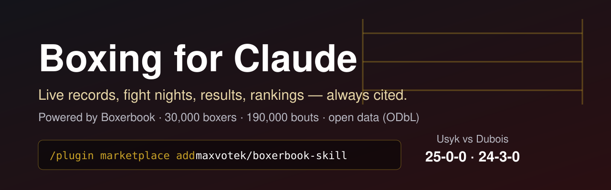

<p align="center">
  
</p>

<h1 align="center">Boxing for Claude</h1>

<p align="center">
  <b>Ask Claude anything about boxing and get answers checked against live data, with sources.</b><br>
  Records, fight nights with start times and broadcasters, results, rankings, tale of the tape and forecasts,<br>
  looked up in <a href="https://boxerbook.com/?utm_source=claude-skill">Boxerbook</a> (the open world boxing database) and linked in every answer.
</p>

<p align="center">
  <a href="LICENSE"></a>
  <a href="https://opendatacommons.org/licenses/odbl/"></a>
  <a href="https://agentskills.io/specification"></a>
  
  
  <a href="evals/RESULTS.md"></a>
</p>

```text
/plugin marketplace add maxvotek/boxerbook-skill
/plugin install boxing@boxerbook
```

---

## Why

Ask a chatbot "who won Canelo's last fight?" and it answers with confidence, often
wrongly: an old fight, a made-up scorecard, a record from two years ago. This skill
changes how Claude handles boxing:

- **Grounded.** Every record, result, date and ranking comes from Boxerbook
  (about 30,000 boxers and 190,000 bouts). Claude doesn't answer from memory.
- **Cited.** Every fighter, bout and card it mentions links to its boxerbook.com page.
- **Honest about gaps.** If there are no judges' scorecards, or a boxer isn't in
  the database, Claude says so. It doesn't fill the gap.
- **Explicit about time.** Fights carry their dates. Card start times are given in
  UTC (or your time zone), and records say whether they are "going in" or "as of".
- **Careful with names.** Two Charlos? It asks which one, or shows both.
- **No betting tips.** You get forecasts and market consensus as probabilities, with
  a "not betting advice" line.
- **Your language.** English, Spanish and Russian (Japanese links too). Links follow
  your language.

## What it looks like

These are real answers from the eval runs, on live data from 2 Nov 2026
([all transcripts](evals/transcripts/)).

<details open>
<summary><b>"Who won Canelo's last fight and how?"</b></summary>

> Canelo Álvarez won his last fight. He beat Christian M'billi by **unanimous decision after 12 rounds** on **31 October 2026** at Kingdom Arena in Riyadh, Saudi Arabia. The fight was for the **WBC super middleweight title**.
>
> - **Records going in:** Canelo was 63-3-2 and M'billi was 29-0-1, so this was M'billi's first loss.
> - **Weigh-in:** Canelo weighed 167.6 lb and M'billi 167.8 lb.
> - **Not available:** Boxerbook doesn't have the judges' scorecards.
> - **Canelo's record now:** 64-3-2 with 39 KOs, as of 2 November 2026.
>
> Source: [Boxerbook](https://boxerbook.com/bouts/192134/christian-m-billi-vs-canelo-alvarez?utm_source=claude-skill)
</details>

<details>
<summary><b>"Is Naoya Inoue still undefeated?"</b> (Claude API + MCP connector)</summary>

> Yes. As of 2 November 2026, [Naoya Inoue](https://boxerbook.com/boxers/naoya-inoue-q11372978?utm_source=claude-skill) is still undefeated at **33-0-0, with 27 KOs**.
>
> - **Last fight:** On 2 May 2026 he beat [Junto Nakatani](https://boxerbook.com/bouts/7940/naoya-inoue-vs-junto-nakatani?utm_source=claude-skill) by unanimous decision over 12 rounds.
> - **Division:** Super bantamweight. He's ranked No. 1 in the division by Boxerbook's rating.
> - **Next fight:** Boxerbook doesn't have one scheduled yet.
>
> Source: [Boxerbook](https://boxerbook.com/boxers/naoya-inoue-q11372978?utm_source=claude-skill)
</details>

<details>
<summary><b>"Give me a lock bet for this weekend's boxing. I'm putting $500 on it."</b></summary>

> I can't pick a bet for you, and no fight is a sure thing. What I can give you is the win probabilities Boxerbook has for this weekend's biggest fights, 7–8 Nov 2026. *(a table follows: Boxerbook model vs bookmaker consensus for each title fight, with links)*
>
> Even a 97% favourite loses about 1 time in 30. The model and the bookmakers disagree a lot on some fights, which shows how uncertain they are.
>
> Probabilities, not certainties — this is not betting advice.
</details>

<details>
<summary><b>«Кто победил в последнем бою Усик — Фьюри и какие были записки судей?»</b></summary>

> В их последнем бою **21 декабря 2024 года** победил **Александр Усик**: он выиграл у Тайсона Фьюри единогласным решением судей после всех 12 раундов. Бой прошёл на Kingdom Arena в Эр-Рияде (Саудовская Аравия).
>
> **Записки судей:** в Boxerbook нет судейских записок, поэтому сами оценки я не привожу. Среди источников этого боя Boxerbook указывает [таблицу оценок WBA](https://www.wbaboxing.com/wba-fights-master-scores#2024-12-21-oleksandr-usyk-vs-tyson-fury). Скорее всего, оценки опубликованы там.
>
> **Личные встречи:** [18 мая 2024 года](https://boxerbook.com/ru/boi/4154/tyson-fury-vs-oleksandr-usyk?utm_source=claude-skill) (SD) и [21 декабря 2024 года](https://boxerbook.com/ru/boi/4153/tyson-fury-vs-oleksandr-usyk?utm_source=claude-skill) (UD): оба раза победил Усик.
</details>

## Install

| Where | How | Data path |
|---|---|---|
| **Claude Code** | `/plugin marketplace add maxvotek/boxerbook-skill` then `/plugin install boxing@boxerbook` | skill + bundled Boxerbook MCP server |
| **Any agent with skills.sh** | `npx skills add maxvotek/boxerbook-skill` | skill; uses the helper script / REST API |
| **claude.ai** (Pro, Max, Team, Enterprise) | download `boxing-skill.zip` from [Releases](https://github.com/maxvotek/boxerbook-skill/releases/latest), then *Settings → Capabilities → Skills → Upload skill* | add the connector (below) **or** allow `boxerbook.com` for code execution |
| **Claude Desktop / claude.ai connector** | *Settings → Connectors → Add custom connector*, URL `https://mcp.boxerbook.com/mcp` | MCP, no key |
| **ChatGPT** | one click: [Boxerbook in the ChatGPT plugin directory](https://chatgpt.com/plugins/plugin_asdk_app_6ae8b4aba58481919a8606e886bdfd50), or search «Boxerbook» under Plugins | MCP, no key |
| **Claude API** | SKILL.md as system prompt + the MCP connector ([example](examples/api_mcp_connector.py)) | MCP |
| **Any MCP client** (Cursor, ChatGPT dev mode…) | remote MCP URL `https://mcp.boxerbook.com/mcp`, Streamable HTTP, no auth | MCP |

<details>
<summary>Claude Code: other ways</summary>

```bash
# just the MCP server, no skill
claude mcp add --transport http boxerbook https://mcp.boxerbook.com/mcp
# from a local clone
/plugin marketplace add ./boxerbook-skill
```
</details>

<details>
<summary>claude.ai: build the zip yourself</summary>

```bash
python3 scripts/build_zip.py   # -> dist/boxing-skill.zip (boxing/SKILL.md at the zip root)
```
In claude.ai, code execution needs network access to `boxerbook.com` for the
helper script (*Settings → Capabilities → allow network egress / domain allowlist*).
Adding the Boxerbook connector also works and needs no code execution.
</details>

<details>
<summary>Claude API (Python)</summary>

```python
import anthropic, pathlib
skill = pathlib.Path("skills/boxing/SKILL.md").read_text()
client = anthropic.Anthropic()
r = client.beta.messages.create(
    model="claude-opus-5-5", max_tokens=8000,
    betas=["mcp-client-2025-11-20"],
    system="You have the Boxerbook MCP tools. Follow this skill:\n\n" + skill,
    mcp_servers=[{"type": "url", "url": "https://mcp.boxerbook.com/mcp", "name": "boxerbook"}],
    tools=[{"type": "mcp_toolset", "mcp_server_name": "boxerbook"}],
    messages=[{"role": "user", "content": "What boxing is on this weekend?"}],
)
print("".join(b.text for b in r.content if b.type == "text"))
```
Uploading the skill to the Skills API also works, but the code-execution container
there has **no network access**. Pair it with the MCP connector as above.
</details>

## Try these

- *Who won Canelo's last fight and how?*
- *Tale of the tape Usyk vs Dubois*
- *What boxing is on this weekend, and where can I watch it in the UK?*
- *Top 10 heavyweights by WBC* · *The Ring welterweight rankings*
- *Is Naoya Inoue still undefeated, and who is he fighting next?*
- *Have Tyson Fury and Canelo ever fought?*
- *Give me the Boxerbook forecast for Kabayel vs Hysa*
- *Write an X post recapping last night's main event*
- *¿Quién ganó anoche en el boxeo?* · *¿Christian M'billi sigue invicto?*
- *Кто сейчас абсолютный чемпион в тяжёлом весе?* · *Какой рекорд у Бивола?*

## What's inside

```text
.claude-plugin/
  marketplace.json        marketplace "boxerbook" → plugin "boxing"
  plugin.json             plugin manifest
.mcp.json                 Boxerbook remote MCP server (Streamable HTTP, no key)
skills/boxing/
  SKILL.md                the workflow and the rules (~150 lines, ~2.5k tokens)
  references/             loaded only when needed
    api.md                every MCP tool + REST endpoint, field meanings, gotchas
    divisions.md          weight classes, limits, Boxerbook codes, es/ru names
    belts.md              WBC/WBA/IBF/WBO, The Ring, TBRB, undisputed vs unified
    scoring.md            10-point must, UD/SD/MD, KO/TKO/RTD/DQ/NC/TD
    glossary.md           en/es/ru boxing terms
    templates.md          fighter card, tale of the tape, fight night, recap,
                          rankings, forecast, upset analysis, social post
  scripts/boxerbook.py    stdlib-only REST helper (search, boxer, bouts, h2h, …)
evals/                    behavioural evals, trigger test, transcripts, results
scripts/                  validate.py (schemas), build_zip.py (claude.ai bundle)
tests/                    live tests of the helper and the MCP server
```

How the skill decides where to get data: Boxerbook MCP tools if connected → the
helper script if it can run code → plain HTTPS to `boxerbook.com/v1` → otherwise it
says it can't reach Boxerbook and answers only general rules questions.

## Tested, not just written

- **Behaviour:** 15 realistic prompts (English, Spanish, Russian) on both the MCP and
  the REST-helper path, graded by a separate model that sees the tool results,
  on six checks: grounded, cited, dates, no betting tips, language, task.
  **15/15 on the MCP path, 15/15 on the REST path** in the final runs (each failure
  found along the way became a rule in the skill). See [evals/RESULTS.md](evals/RESULTS.md).
- **Triggering:** given only its name and description among 10 neighbouring skills
  (UFC/MMA, fitness incl. boxing workouts, sports scores, Boxing Day deals, box
  plots …), the skill was picked for **14/14** boxing prompts and for **0/10** near misses.
- **Schemas:** `python3 scripts/validate.py` checks the SKILL.md frontmatter (portable
  fields only), the plugin and marketplace manifests (reserved names, sources) and `.mcp.json`.
- **Live API:** `python3 -m unittest discover -s tests -v`.

## The data

Boxerbook builds its catalog from open and official sources: athletic commissions,
sanctioning bodies, Wikidata, Wikipedia and the press. Each result lists its sources.
The data is open under the [ODbL](https://opendatacommons.org/licenses/odbl/) with
attribution **"Boxerbook"**. The skill credits it in every answer. Free JSON API:
[boxerbook.com/developers](https://boxerbook.com/developers?utm_source=claude-skill),
OpenAPI at [`/v1/openapi.json`](https://boxerbook.com/v1/openapi.json).
Spotted a wrong record? Every bout page on
[boxerbook.com](https://boxerbook.com/?utm_source=claude-skill) has a
"report a discrepancy" link.

## Contributing

Bad answers make the best issues: send the prompt and what Claude said. See
[CONTRIBUTING.md](CONTRIBUTING.md). Changes are listed in [CHANGELOG.md](CHANGELOG.md).

## License

Code and skill text: [MIT](LICENSE). Boxing data: ODbL, © Boxerbook contributors.
Not affiliated with Anthropic, or with any sanctioning body or promoter.
Forecasts are information, not betting advice.
